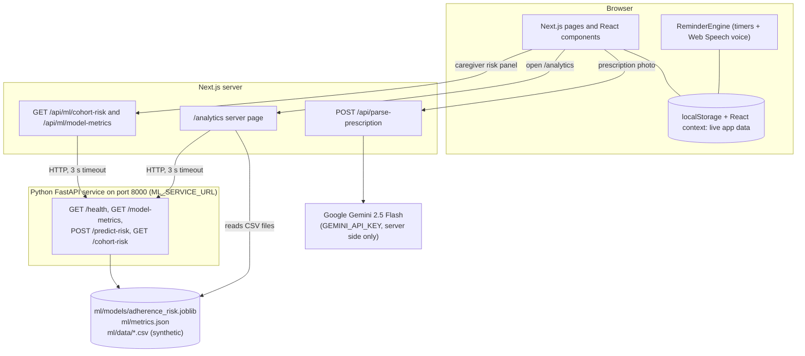

# CareCompanion AI

An AI-assisted medication reminder and caregiver-support prototype for older adults. Capstone project, Phase 1 (Review 2) plus an adherence-intelligence prototype.

## 1. What it is

CareCompanion AI is a Next.js web app. It reads a prescription photo with Google Gemini, lets the user check and edit the result, turns it into a daily medicine schedule, reminds the patient by voice, and shows a caregiver what was taken, pending or missed. A separate Python service estimates which patients in a **simulated** cohort are likely to miss their next dose.

It is an academic prototype. It is **not a medical device**, has not been clinically validated, and must not be used to make treatment decisions.

### Problem statement

Elderly patients with chronic conditions often struggle with complex daily medication regimens, ambiguous handwritten prescriptions, and hard-to-remember schedules. Skipping critical medications or taking incorrect doses can cause preventable medical complications, and it places a heavy emotional burden on family caregivers who cannot easily see what is happening.

## 2. Features

| Feature | Where | What it does |
|---|---|---|
| Patient "Today" view | `/dashboard` | Lists today's doses for the selected patient by time of day. Each dose shows Taken, Pending or Missed. The user can mark a dose taken or missed, undo it, edit or delete the medicine, and play the voice reminder. |
| Prescription scan with review | `/upload` | Photo (JPG, PNG, WebP or HEIC, up to 5 MB) goes to `/api/parse-prescription`, which asks Gemini 2.5 Flash to read it. The key stays on the server. Every medicine appears in editable fields, and nothing is added to the schedule until the user confirms. A built-in sample prescription is available when there is no photo or no API key. |
| Add or edit a medicine by hand | `/add-medicine` | Form for a medicine, its dose times and duration. |
| Several patients | `/patients` | Create, select and delete patient profiles (stored in the browser). |
| Spoken, multilingual reminders | `components/ReminderEngine.tsx`, `components/ReminderModal.tsx` | At each dose time a dialog opens and the reminder is spoken with the browser's Web Speech API. 10 languages: English, Hindi, Tamil, Telugu, Kannada, Malayalam, Marathi, Bengali, Spanish, French. |
| Caregiver view | `/caregiver` | Today's summary and timeline, a "Needs attention" list (missed doses and reminder alerts), symptom notes, an editable care plan, and a risk panel for the simulated cohort. |
| Adherence analytics | `/analytics` | Key numbers and charts over a simulated cohort, the model summary, and a sortable patient risk table. |

## 3. Architecture



Two things to keep in mind when reading the diagram:

- **Live app data stays in the browser.** Patients, medicines, dose logs and notes are kept in React context and saved to `localStorage`. No database is connected.
- **The PostgreSQL schema is a design document only.** `docs/database/schema.sql` and `docs/database/migrations/002_adherence_intelligence.sql` are not applied anywhere and no code reads them.

The browser never talks to the Python service directly. Only the Next.js server does. A longer version of this diagram, with sequence diagrams, is in [docs/architecture/architecture.md](docs/architecture/architecture.md).

## 4. Data flow

### (a) Prescription to caregiver view

1. On `/upload` the user picks a photo. The browser checks the type and the 5 MB limit.
2. The browser converts the photo to base64 and sends it to `/api/parse-prescription`.
3. The route checks the type, the size and the base64 text, reads `GEMINI_API_KEY` from the server environment, and asks Gemini 2.5 Flash for JSON (30 second timeout).
4. The route cleans up the answer: dose slots (morning, afternoon, evening, night), a valid `HH:MM` time (or the usual time for the slot), and a duration (30 days if missing). The patient name is `null` when it is not on the prescription.
5. The review screen shows every medicine in editable fields. The user can fix values or untick a medicine. A warning appears if the name on the prescription does not match the selected patient.
6. When the user confirms, `addMedicines` (in `context/AppContext.tsx`) adds the medicines to the selected patient and creates a pending dose log for today for each time. The state is saved to `localStorage`.
7. `ReminderEngine` checks once a second. When the clock matches a reminder time and the dose is not already taken or missed, a dialog opens and the reminder is spoken in the patient's language.
8. The patient presses "I have taken it" and the dose becomes **taken** with a time stamp. "Remind me" repeats the reminder later. If the third reminder gets no answer, the dose becomes **missed** and an alert is added for the caregiver. The Today page also lets the user mark a dose taken or missed by hand.
9. `/caregiver` reads the same state and shows the summary, timeline, alerts, notes and care plan.

### (b) Synthetic data to analytics page and caregiver panel

1. `ml/generate_synthetic_data.py` writes `patients.csv`, `dose_events.csv`, `app_activity.csv` and `metadata.json` to `ml/data/` (seed 42).
2. `ml/train_model.py` builds one training example per decided dose, compares three models, saves the selected one to `ml/models/adherence_risk.joblib` and writes `ml/metrics.json`.
3. The FastAPI service (`ml/api.py`) loads the model, the metrics and the CSV files at start-up. It scores all 250 patients once, at the reporting cutoff (2026-10-13 14:00).
4. Each request to `/analytics` is rendered on the server. It reads the CSV files and computes the key numbers and charts in TypeScript. In the same request it asks the ML service for `/model-metrics` and `/cohort-risk`.
5. The caregiver page calls `/api/ml/cohort-risk?limit=5` (a Next.js route that forwards to the service) and shows the five highest-risk simulated patients.
6. If the service cannot be reached, those parts show an "unavailable" notice. No predictions are made up.

## 5. Getting started

### Prerequisites

- **Node.js 20.9 or newer** (required by Next.js 16) and npm. The tests were run with Node v22.23.2.
- **Python 3.10 or newer** and `venv`, only for the ML service. The code uses the `int | None` type syntax. The ML service was built and tested with Python 3.13.5.

The commands below use macOS/Linux paths.

### Install and configure

```bash
npm install
cp .env.local.example .env.local
```

`.env.local` contains two settings:

```bash
# Used server-side only by /api/parse-prescription to read prescription photos.
GEMINI_API_KEY=your_gemini_api_key_here

# Server-side only; base URL of the Python ML service. Used by /analytics and /api/ml/*.
ML_SERVICE_URL=http://127.0.0.1:8000
```

- `GEMINI_API_KEY` is optional. Without a valid key the scan page shows a clear error and offers the sample prescription instead.
- `ML_SERVICE_URL` defaults to `http://127.0.0.1:8000` in the code if it is not set.

### Run the web app

```bash
npm run dev
```

> **Warning:** the project's `dev` script (`scripts/dev.js`) first **stops any process that is listening on port 3000**, then starts `next dev --webpack` and opens the browser. If port 3000 is used by something else you want to keep, use this instead:
>
> ```bash
> npx next dev --webpack --port 3100
> ```

Open <http://localhost:3000> (or the port you chose).

### Run the ML service (optional, needed for the risk model)

```bash
python3 -m venv ml/.venv
ml/.venv/bin/pip install -r ml/requirements.txt

# Optional: the data, the trained model and metrics.json are already in the repository.
ml/.venv/bin/python ml/generate_synthetic_data.py   # regenerate the CSV files (same seed gives the same files)
ml/.venv/bin/python ml/train_model.py                # retrain; rewrites ml/models/adherence_risk.joblib and ml/metrics.json

cd ml && .venv/bin/uvicorn api:app --port 8000
```

`uvicorn` listens on `127.0.0.1` unless told otherwise. Keep it that way: the service has no login. Check it with `curl http://127.0.0.1:8000/health`; when everything loaded it reports `"status": "ok"`.

### If the ML service is not running

| Part of the app | What happens |
|---|---|
| `/analytics` key numbers and charts | Still work. They come from the CSV files, not from the service. |
| `/analytics` risk-band card, model summary and patient risk table | Show "Model service unavailable" with the start command. |
| Caregiver page risk panel | Shows "Risk model unavailable" with a "Try again" button. |
| Everything else (Today, scan, reminders, patients) | Not affected. |

No prediction is ever invented when the service is down.

## 6. Dataset

The analytics and the model use **synthetic** data. No accessible, licensed, patient-level medication-adherence dataset was found. The NIH / data.gov entry on a cohort study of over-reporting of antihypertensive adherence has no downloadable patient records, so it is cited only as background reading and was not used to generate any value (see the data card).

| Item | Value |
|---|---|
| Simulated patients | 250 (`P001` to `P250`) |
| Period | 90 days, 2026-07-16 to 2026-10-13 |
| Random seed | 42 |
| Files | `ml/data/patients.csv`, `dose_events.csv`, `app_activity.csv`, `metadata.json` |
| Reproduce | `ml/.venv/bin/python ml/generate_synthetic_data.py` (the same seed and arguments give byte-identical files) |

Fields, generation rules, summary statistics and limits are in [ml/data/DATA_CARD.md](ml/data/DATA_CARD.md). The relationships in the data (for example, reminders on means fewer missed doses) were written into the generator by hand. They are not findings about real people.

## 7. Metric definitions

These definitions are used by `lib/adherence.ts` and `lib/analytics.ts` and by the analytics page.

| Metric | Definition |
|---|---|
| Known outcome | A dose that is `taken` or `missed`. Pending and future doses have no known outcome and are left out of rates. |
| Dose adherence rate | taken ÷ doses with a known outcome × 100 |
| Missed-dose rate | confirmed missed ÷ doses with a known outcome × 100 (`missedRate` in `lib/adherence.ts`, checked by tests, not shown as a card on the analytics page) |
| When a dose counts as missed | Only after its scheduled time + 120 minutes (the grace period). Before that it is pending. |
| Fully adherent patients | Distinct patients who took **every** dose scheduled at or before the 14:00 cutoff. A due dose that is still pending counts as not taken. Patients with no dose due by the cutoff are not counted at all. The analytics page shows this for the reporting date. |
| Daily active patients | Distinct patients with at least one app activity event (`app_open`, `dashboard_view` or `reminder_response`) that day |
| 7-day active patients | Distinct patients with at least one activity event in the trailing 7 calendar days, ending on and including the reporting date |
| Patient counts and dose counts | Reported separately and labelled. One patient has many doses, so the two are never mixed in one number. |
| Timezone | Asia/Kolkata (IST). Dates and times in the files are local, with no UTC offsets. |
| "Today" on `/analytics` | The dataset's reporting date, **2026-10-13**, with a cutoff of **14:00**. It is not the computer's clock. |

The Today and caregiver pages of the live app use the same rule (taken ÷ (taken + missed), pending left out) on the patient's real doses for the current day.

## 8. The model

**Target.** The probability that the patient's next scheduled dose is missed, meaning not taken within 120 minutes of its scheduled time.

**Features** (13 in total, the same code is used for training and for the service):

| Group | Features |
|---|---|
| Recent behaviour | adherence over the last 7 days, missed doses in the last 7 days, whether the most recent dose was missed, reminder acknowledgement rate (last 14 days), typical delay before taking a dose (last 14 days), days the app was opened in the last 7 days |
| Patient profile | reminders switched on, daily medicine count, family caregiver support, number of chronic conditions, age band |
| The dose being predicted | time of day (slot), falls on a weekend |

A past dose only counts if its 120-minute window had already closed at the time of prediction, so the answer to the question is never used as an input. `engagement_level` (the generator's hidden trait) and `preferred_language` are deliberately not used.

**Method** (`ml/train_model.py`):

1. One example per decided dose, starting 7 days after the start of the data. Doses that are still pending are never examples.
2. Split by patient (`GroupShuffleSplit`, 20% of patients held out, `random_state=42`) so no patient is in both the training and the test set.
3. Three candidates: a baseline that always predicts the training class share, logistic regression, and a random forest.
4. 5-fold cross-validation grouped by patient (`GroupKFold`) on the training patients, scored by ROC-AUC.
5. **Selection rule:** the better of logistic regression and random forest by mean cross-validation ROC-AUC is saved. A tie goes to logistic regression. The test patients play no part in this choice.
6. Every candidate is then scored once on the held-out patients at the 0.5 threshold.

**Data used:** 43,512 examples. 200 training patients (35,338 examples) and 50 test patients (8,174 examples). Missed doses are 20.3% of training examples and 21.5% of test examples.

**Results**, copied from `ml/metrics.json`:

| Model | CV ROC-AUC (mean ± std, 5 folds) | Test accuracy | Test precision | Test recall | Test F1 | Test ROC-AUC |
|---|---|---|---|---|---|---|
| Baseline (class share) | 0.5000 ± 0.0000 | 0.7852 | 0.0000 | 0.0000 | 0.0000 | 0.5000 |
| Logistic regression (**selected**) | 0.7807 ± 0.0209 | 0.8361 | 0.6929 | 0.4254 | 0.5272 | 0.8040 |
| Random forest | 0.7793 ± 0.0208 | 0.8351 | 0.7012 | 0.4049 | 0.5134 | 0.8038 |

Selected model: `logistic_regression`. Model version: `logistic_regression-83bd2537`. These numbers change if the data or the code changes and the model is retrained.

**How to read these results**

- The data are synthetic and were made by hand-written rules, so the model partly re-learns those rules. The scores say little about real patients.
- About 174 examples come from each patient and only 50 patients are in the test set. The examples are not independent, there are no confidence intervals, and there is a single split.
- Always predicting "taken" already gets 78.5% accuracy, so accuracy alone is misleading.
- The two real models are almost tied (cross-validation gap 0.0014, fold-to-fold spread about 0.02), so choosing logistic regression is not strongly supported.
- Probabilities were not calibrated and no calibration check was done.

See [ml/README.md](ml/README.md) for the full model card (feature definitions, leakage rule, API, limits).

## 9. Reading the risk output

- **Probability** is the model's estimate of the chance that the next dose is missed. It is a model score, not a measured frequency.
- **Bands:** low is below 30%, moderate is 30% up to 60%, high is 60% and above. These are **prototype thresholds**. They are not medically validated and were not tuned on the results above.
- **"Why the model flagged this patient"** (caregiver panel). For each feature the service swaps the patient's value for a typical value (the training median, or the most common slot), scores again, and reports how much lower the estimate becomes (an "occlusion" explanation). Up to three factors that raise the estimate are shown, as "+N points" against the typical value. This is **different** from the global importance chart on `/analytics`, which shows how much the test ROC-AUC drops when a feature is shuffled across all test patients.
- **Supportive next steps** are fixed, non-medical suggestions (for example "check that reminders can be heard"), chosen only from the factors shown. The panel always adds: do not change medicines or doses, talk to the doctor if there are concerns. It never advises changing a medicine.
- Every patient in the risk panel is labelled "simulated". They are separate from the real patient profiles stored in the browser.

## 10. Testing

```bash
npm run lint
npx tsc --noEmit
npm test
cd ml && .venv/bin/python -m pytest tests -q
```

`npm test` runs `node --test "tests/*.test.mjs"`. The Python tests read the saved model and `metrics.json` (they do not retrain), so install the ML requirements first.

| File | What it covers |
|---|---|
| `tests/phase1.test.mjs` | Phase-1 checks: the AI sample output has the right shape, `schema.sql` defines the three tables with their keys and status check, adherence on a 3-dose example, the 12-hour time formatter, the prescription route exists and does not use a `NEXT_PUBLIC` key, removed Phase-2 endpoints stay removed, team and review documents exist |
| `tests/adherence-metrics.test.mjs` | `lib/adherence.ts`: counting by status, rates leave out pending doses, missed rate, fully-adherent rule; time formatter; local date helpers |
| `tests/analytics.test.mjs` | `lib/analytics.ts`: header from the metadata, patient counts versus dose counts, doses due by the cutoff, pending never counted as missed, overall rate, fully adherent patients, distinct active patients, 7-day window, 30-day daily series, adherence histogram edges, reminder by caregiver-support groups, date arithmetic |
| `tests/analytics-page.test.mjs` | `/analytics` has `loading.tsx` and `error.tsx`, is rendered per request, carries the demo label, hard-codes no KPI numbers, shows an unavailable notice instead of predictions |
| `tests/ml-client.test.mjs` | `lib/ml-client.ts`: response shape checks, URL and no-cache setting, `ML_SERVICE_URL`, bad JSON or shape, HTTP 503, network error, timeout |
| `ml/tests/test_data.py` | 250 unique patient IDs, references between files, dose count per patient, statuses and `taken_at` fields, the 120-minute grace rule and the cutoff, activity not after the cutoff, reminder flags, regeneration gives byte-identical files |
| `ml/tests/test_features.py` | The documented feature list, no leakage from unresolved or pending doses, window edges, empty history gives "missing" not zero, slot boundaries, training table matches the single-call path |
| `ml/tests/test_train.py` | Split by patient, saved counts match, required keys, selected model has the higher CV mean, values in range, importances sorted, reliability notes present, saved model matches the metrics |
| `ml/tests/test_api.py` | `/health`, `/model-metrics`, `/predict-risk` (valid input, same answer as the cohort, invalid input rejected), `/cohort-risk` (order, limit check), degraded mode when the model file is missing |

When this README was written, `npm run lint` and `npx tsc --noEmit` reported no problems, 48 Node tests passed and 64 Python tests passed.

## 11. Limitations and what real data would need

**Limitations**

- **Synthetic, rule-generated data.** The model partly re-learns the generator's rules, so its scores are not evidence about real people.
- **Correlated examples.** Doses from the same patient resemble each other, so the test results are less certain than the example count suggests.
- **Low recall at the 0.5 threshold.** The selected model finds 42.5% of missed doses (recall 0.4254) with 69.3% precision.
- **No calibration and no clinical validation.** The 30% and 60% bands are prototype values.
- **"Missed" means two different things.** In the dataset and the model a dose is missed when it is not taken within 120 minutes. In the live app a dose becomes missed only after the third reminder goes unanswered, or when someone marks it missed by hand. The reminder repeat interval is 5 minutes in the code, but a "fast demo mode" flag that is on by default (and has no switch in the interface) makes it 1 minute. The model was not trained on the app's own rule.
- **Single browser, no database, no login.** Live data is in one browser's `localStorage`. Alerts, reminder history and open reminders are kept only in memory and are lost on reload. The caregiver view is a page in the same browser, not a separate caregiver device or account.
- **Reminders only run while the app is open** in a browser tab, for the selected patient. There is no SMS, WhatsApp, phone call or push notification.
- **Voices depend on the browser.** If no voice exists for the chosen language the code falls back to an English or any available voice, so pronunciation may be poor.
- **Prescription reading is a feasibility test.** It was tried on the sample prescription and no accuracy figure was measured. The review-and-edit step exists because the AI can misread.
- **ML service has no login.** It should listen on localhost only. Request bodies are not logged.
- **Prescription photos are sent to Google's Gemini API.** Do not upload real patient prescriptions in a demo.

**What further evaluation would need**

- Consented, de-identified real adherence records (for example smart pill-box or pharmacy refill data), with ethics approval and a data-protection review.
- External validation on a separate population, and checks of calibration.
- Clinician review of the thresholds and of the caregiver wording.

## 12. Phase boundary and Phase-1 modules

> This repository contains the **Phase-1 Review 2** milestone and an **adherence-intelligence prototype** built on simulated data. Production deployment, real patient data, external messaging (SMS, WhatsApp, phone), a persistent multi-user database and user login are outside the current scope. No clinical validation or medical certification is claimed.

Summary of the four Phase-1 modules:

| Module | What was delivered | Details |
|---|---|---|
| 1. System architecture | Next.js app, a route handler that validates the photo and calls Gemini with a server-side key, and the data flow between them. Now also covers the ML service. | [docs/architecture/architecture.md](docs/architecture/architecture.md) |
| 2. Database schema design | Three PostgreSQL tables in `schema.sql`: `PatientProfile`, `MedicationSchedule`, `AdherenceLog` (status `taken`, `pending`, `missed`). A design-only extension, `docs/database/migrations/002_adherence_intelligence.sql`, shows where the adherence-intelligence data would go. Neither is connected to the app. | [docs/database/README.md](docs/database/README.md), [docs/database/schema.sql](docs/database/schema.sql) |
| 3. UI/UX prototype | Patient and caregiver screens with Taken, Pending and Missed states and a daily adherence rate. | [docs/ui/README.md](docs/ui/README.md) |
| 4. AI proof of concept | Prescription image to structured JSON (`patient`, `medications`) with Gemini 2.5 Flash. Checked against the Review 2 sample: Mr. Ramesh (72 yrs), Telmisartan 40 mg in the morning for 30 days, Amlodipine 5 mg at night for 30 days. | [docs/ai-poc/README.md](docs/ai-poc/README.md) |

Review report: [docs/PHASE_1_REVIEW_2.md](docs/PHASE_1_REVIEW_2.md).

## 13. Team contributions

| Team Member | Registration No. | Phase 1 Execution |
|---|---|---|
| **Sahil Sahani** | 23BCE10123 | Designed responsive UI wireframes & dashboard mockups. |
| **Kavyansh Vats** | 23BCE10301 | Mapped backend architecture & serverless API flow. |
| **Samiksha Vijayvargiya** | 23BCE10725 | Built working PoC for Gemini prescription extraction. |
| **Pakhi Shukla** | 23BCE10847 | Evaluated TTS engines for multilingual voice reminders. |
| **Tanushri Sukhwal** | 23BCE10680 | Finalized database schemas for patients & schedules. |

Full attribution report: [docs/team-contributions.md](docs/team-contributions.md)
