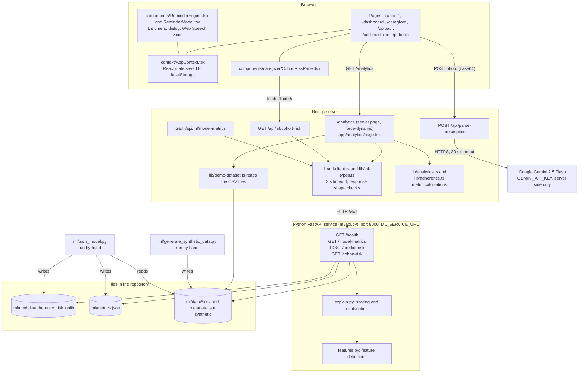
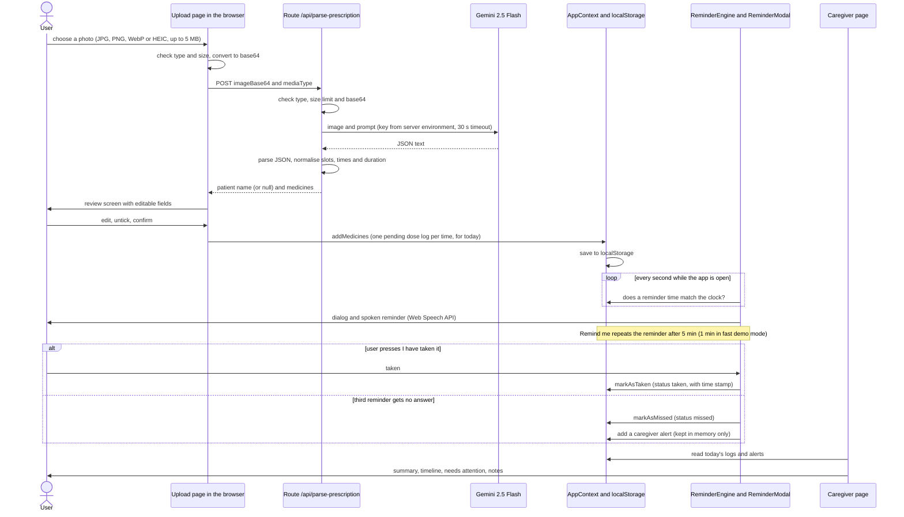
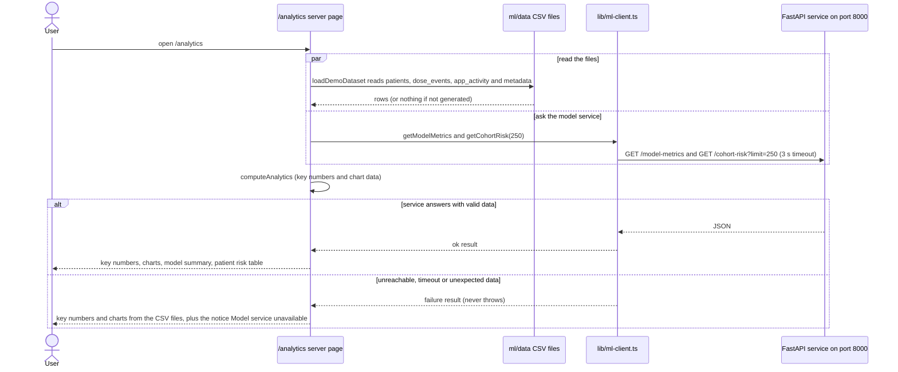

# Module 1 — System Architecture & Data Flow

## 1. Overview

CareCompanion AI is a Next.js web app for medication reminders and caregiver visibility. It has three parts that run separately:

1. **The web app** (Next.js, React). Pages run in the browser. A few server-side pieces (route handlers and one server-rendered page) run on the Next.js server.
2. **The prescription reader.** A Next.js route handler that sends a prescription photo to Google Gemini 2.5 Flash. The API key stays on the server.
3. **The ML service.** A small Python FastAPI service that serves a missed-dose risk model trained on **synthetic** data. Only the Next.js server calls it.

Live app data (patients, medicines, dose logs, notes) is kept in the browser. No database is connected. The PostgreSQL schema in `docs/database/` is a design document only.

> **About the PNG in this folder.** `architecture-diagram.png` (and the copy `architecture_diagram.png` at the repository root) is an older Phase-1 drawing. It still shows `/api/summarize-consultation`, `/api/health-insights`, "Hosted on Vercel" and a "Pre-Visit Doctor Report". None of these exist in this repository. The Mermaid diagrams below are the current ones.

### 1.1 Component diagram

Notes on the diagram:

- The browser never calls the Python service. Only `lib/ml-client.ts` (on the Next.js server) does.
- `GET /api/ml/model-metrics` exists as a proxy route, but no page calls it. `/analytics` calls `lib/ml-client.ts` directly.
- `POST /predict-risk` is available on the service (and tested), but no page of the web app calls it yet. The pages only use the precomputed cohort scores.
- The generator and the training script are run by hand. They are not part of the running service.

### 1.2 Sequence: prescription scan to caregiver view

### 1.3 Sequence: the /analytics page

If the CSV files are missing, the page shows "No demo data found" with the command that generates them, and the model sections still work. If they are present but malformed, `app/analytics/error.tsx` shows an error with a "Try again" button.

## 2. Architectural Layers

### 2.1 Client layer (browser)

- **Framework**: React 19 and Next.js 16 (App Router), Tailwind CSS.
- **Pages**: `/` (home), `/dashboard` (Today), `/caregiver`, `/upload` (scan prescription), `/add-medicine`, `/patients`, `/analytics`.
- **State**: `context/AppContext.tsx` holds patients, medicines, dose logs and symptom notes in React state and saves them to `localStorage`. The saved keys are `cc_profiles`, `cc_activeProfileId`, `cc_allMedicines`, `cc_allTrackingLogs`, `cc_allSymptomLogs` and `cc_theme`. Open reminders, reminder history and caregiver alerts are React state only and are **not** saved. On a first visit the app starts with two demo patients (Mr. Ramesh and Mrs. Kamla).
- **Reminders**: `ReminderEngine` (mounted in `app/layout.tsx`) checks the clock every second for the selected patient's medicines. `ReminderModal` shows the dialog with "I have taken it" and "Remind me" buttons. Speech uses the browser's Web Speech API in 10 languages (English, Hindi, Tamil, Telugu, Kannada, Malayalam, Marathi, Bengali, Spanish, French). Up to three reminders are given. After the third goes unanswered the dose is marked missed and a caregiver alert is created. The repeat interval is 5 minutes in the code, but `isFastDemoMode` is on by default and has no switch in the interface, which makes it 1 minute.
- **Caregiver risk panel**: `CohortRiskPanel` fetches `/api/ml/cohort-risk?limit=5`, checks the shape of the answer, and shows an "unavailable" notice if anything is wrong.

### 2.2 Next.js server layer

**`POST /api/parse-prescription`** (`app/api/parse-prescription/route.ts`)

| Step | Check or action | Result on failure |
|---|---|---|
| 1 | Body has a non-empty `imageBase64` string | 400 |
| 2 | `mediaType` is `image/jpeg`, `image/png`, `image/webp`, `image/heic` or `image/heif` | 400 |
| 3 | Base64 text is at most 6,990,000 characters (about 5 MB once decoded) | 413 |
| 4 | Text matches a base64 pattern | 400 |
| 5 | `GEMINI_API_KEY` is set on the server | 503 |
| 6 | Call Gemini 2.5 Flash with a 30 second timeout, asking for JSON only | 504 on timeout, 502 on a Gemini error |
| 7 | Parse the JSON text | 502 if it is not valid JSON or has no text |
| 8 | Normalise each medicine (see below) | any other error gives 500 |

Normalising: the dose slots are limited to morning, afternoon, evening and night (default morning), the time must be `HH:MM` (otherwise the usual time for the slot is used: 08:00, 13:00, 18:00, 21:00), and the duration must be a positive number (default 30 days). The patient name is `null` when it is not written on the prescription (the prompt says never to invent one, and values such as "null", "none", "n/a" or "unknown" are also turned into `null`). The response has `success`, `patient`, `medications` and a `meds` list shaped for the review screen.

**`GET /api/ml/cohort-risk` and `GET /api/ml/model-metrics`** (`app/api/ml/`)

- Forward to the Python service through `lib/ml-client.ts`. Both are `force-dynamic` and send `Cache-Control: no-store`.
- `cohort-risk` accepts an optional `limit` (a whole number from 1 to 250). Anything else gets 400.
- When the service fails, both return 503 with `{"error": "Model service unavailable", "reason": ...}`.

**`lib/ml-client.ts`**

- Base URL from `ML_SERVICE_URL` (default `http://127.0.0.1:8000`), default timeout 3000 ms, no caching.
- Checks every answer against the types in `lib/ml-types.ts`. It never throws: a failure becomes `unavailable`, `timeout` or `bad_response`.
- Response bodies are never logged, because they can contain per-patient predictions.

**`/analytics`** (`app/analytics/page.tsx`)

- Rendered on every request (`export const dynamic = "force-dynamic"`).
- Reads the CSV files through `lib/demo-dataset.ts` (server only) and calculates the numbers with `lib/analytics.ts`. In the same request it asks the ML service for `/model-metrics` and `/cohort-risk`.

### 2.3 AI vision engine

- **Model**: Google Gemini 2.5 Flash (`gemini-2.5-flash`), called from the route with an API key.
- **Role**: read a handwritten or printed prescription image and return the patient name and a list of medicines (name, dosage, timing, exact time, duration, instructions) as JSON.
- **Limit**: the output can be wrong. That is why `/upload` always shows a review and edit screen and adds nothing until the user confirms. No accuracy figure has been measured.

### 2.4 ML layer (Python FastAPI service)

Code is in `ml/`. Full detail and the model card are in [ml/README.md](../../ml/README.md).

| Endpoint | Purpose |
|---|---|
| `GET /health` | Reports `ok` or `degraded`, whether the model and data loaded, and the model version |
| `GET /model-metrics` | Returns `ml/metrics.json` |
| `POST /predict-risk` | Scores one patient from the history in the request. Unknown fields are rejected, input is validated and capped, and errors do not echo the payload. |
| `GET /cohort-risk?limit=N` | Precomputed scores for the 250 synthetic patients at the reporting cutoff, highest risk first |

- At start-up the service loads the model file, `metrics.json` and the CSV files, and scores the whole cohort once.
- If a file is missing the service still starts in degraded mode. `/health` says `degraded` and the endpoints that need the missing piece return 503.
- The model estimates the probability that the next dose is missed (not taken within 120 minutes). It was trained on synthetic data only. The risk bands (low below 0.30, moderate 0.30 to below 0.60, high 0.60 and above) are prototype thresholds, not medically validated.

### 2.5 Data and persistence

| Data | Where it lives |
|---|---|
| Live app data (patients, medicines, dose logs, notes) | Browser `localStorage`, one browser only |
| Open reminders, reminder history, caregiver alerts | Browser memory only, lost on reload |
| Analytics and training data | `ml/data/*.csv` and `metadata.json` (synthetic, committed to the repository) |
| Trained model and results | `ml/models/adherence_risk.joblib` and `ml/metrics.json` |
| PostgreSQL design | `docs/database/schema.sql` (Phase-1 base) and `docs/database/migrations/002_adherence_intelligence.sql` (design only). Not applied anywhere. The app has no database driver. |

## 3. Security and privacy notes

1. **API key stays on the server.** `GEMINI_API_KEY` is read from `process.env` inside the route handler only. It is not prefixed with `NEXT_PUBLIC_` and is not sent to the browser. `.env.local` is git-ignored. Only `.env.local.example` (with a placeholder) is committed. A test checks that the route does not use a `NEXT_PUBLIC` key.
2. **Validation before any outside call.** The route checks the image type, size and base64 text before it calls Gemini.
3. **The ML service has no authentication.** It should listen on localhost only (`uvicorn` does this by default) and be reached only by the Next.js server. The browser never calls it. If it were ever exposed, a login or network rule would be needed first.
4. **No request payload logging.** The Python service does not log request bodies or patient data, and its validation errors do not repeat the input. `lib/ml-client.ts` does not log response bodies. The prescription route logs only a short error message and status, not the image.
5. **Prescription photos leave the machine.** The photo is sent to Google's Gemini API. Real patient prescriptions should not be used in a demo.
6. **The model file is a pickle.** `ml/models/adherence_risk.joblib` is loaded with `joblib`. Only load model files from a source you trust (here, the repository itself).
7. **Prototype limits.** `/api/parse-prescription` has no login and no rate limit, so anyone who can reach the server can use the key's quota.
8. **Clear boundary between prototype and design.** The documents say plainly what runs (browser state, CSV files, the Python service) and what is design only (the PostgreSQL schema and migration).

## 4. Architectural evidence

- The current diagrams are the Mermaid blocks in section 1 of this file.
- `architecture-diagram.png` in this folder is the older Phase-1 drawing described in the note at the top of this file. It is kept for the record only.
